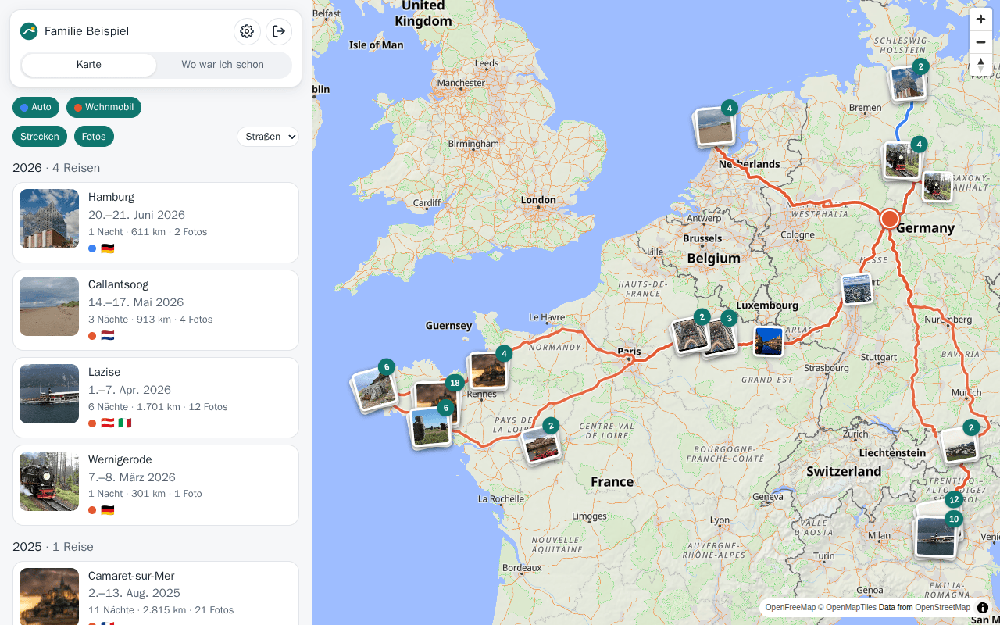
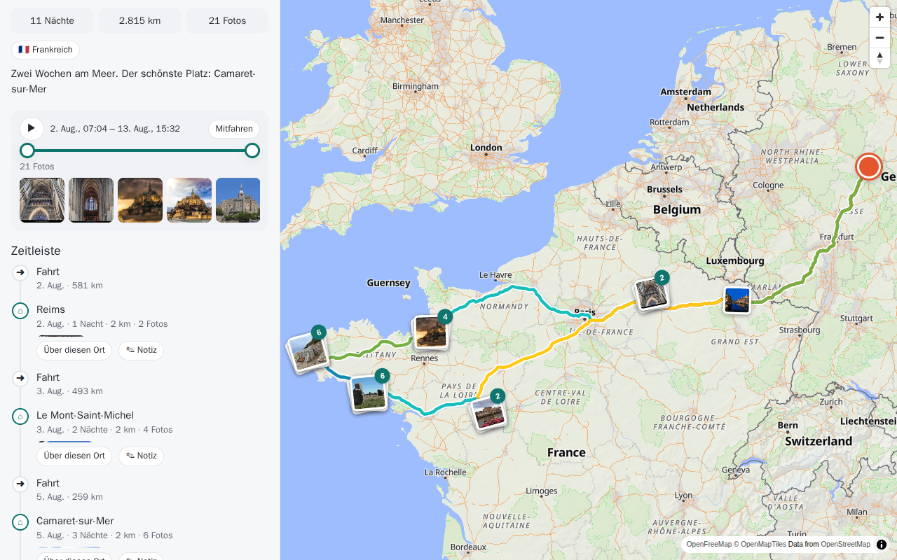
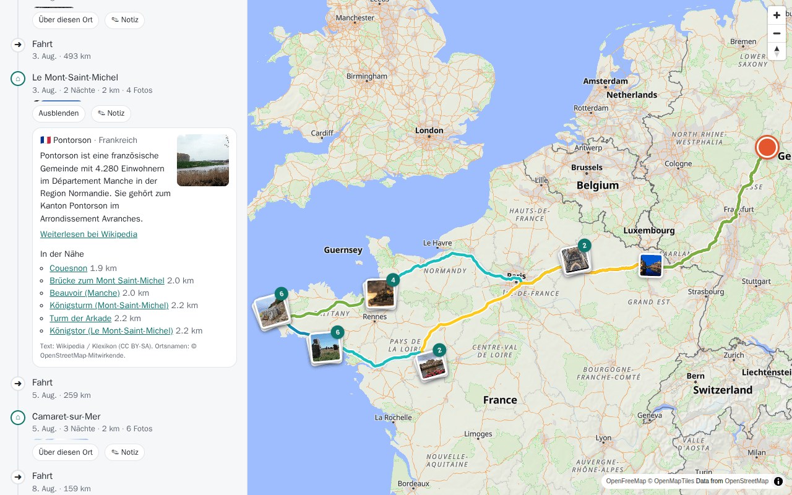
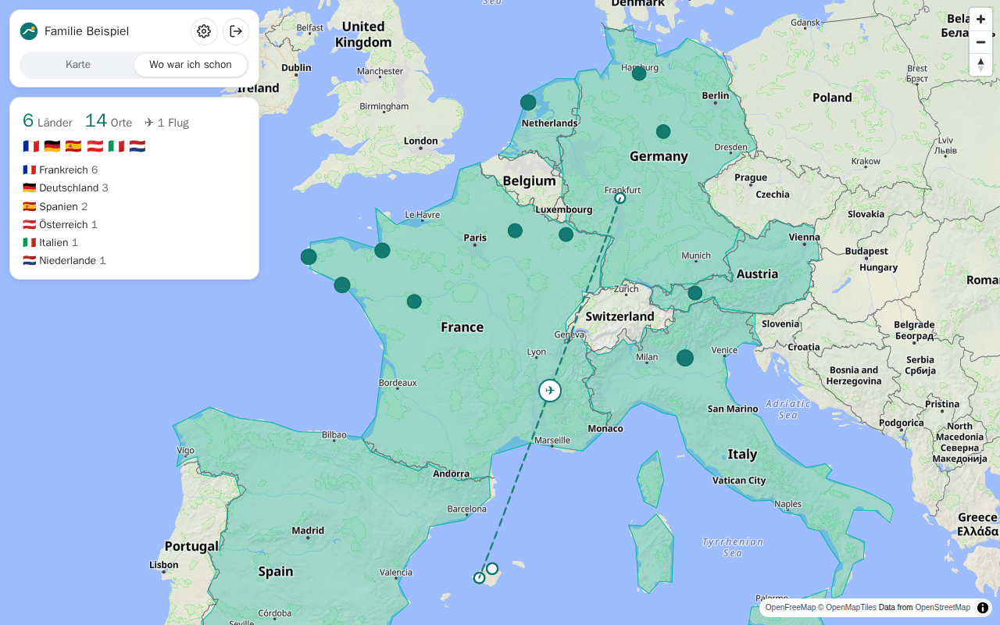
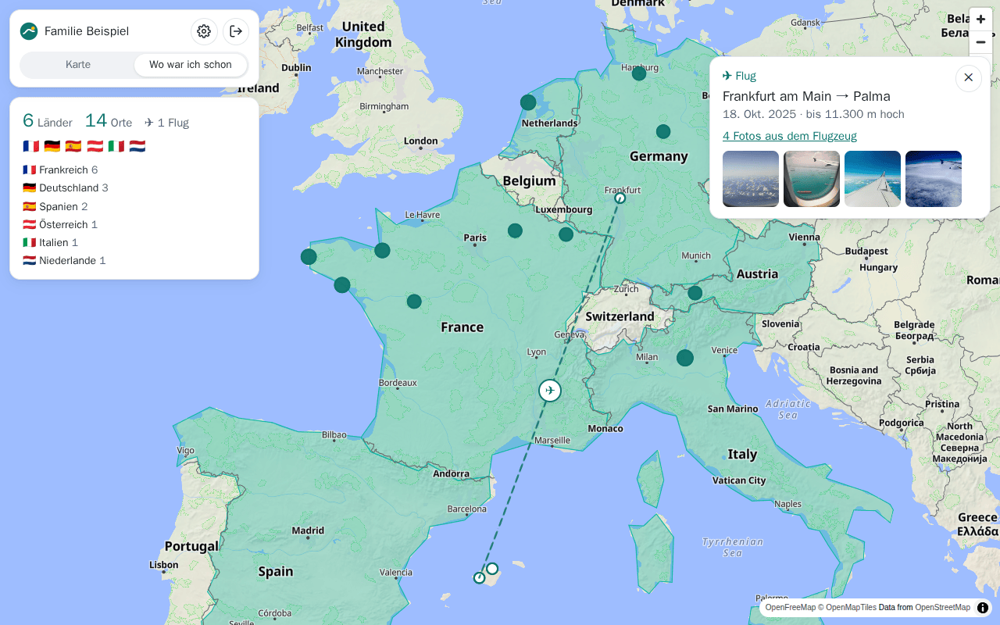
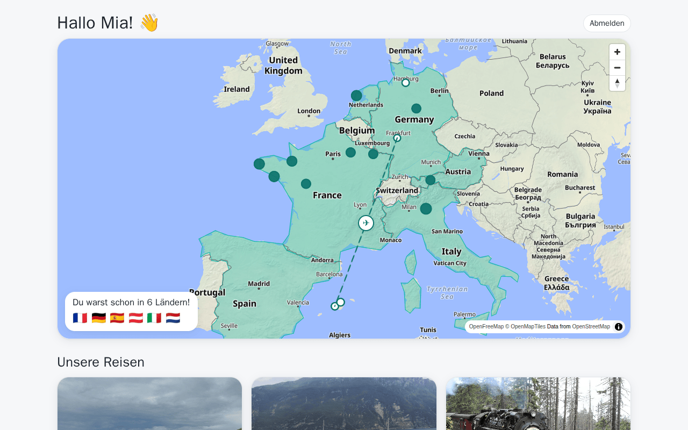
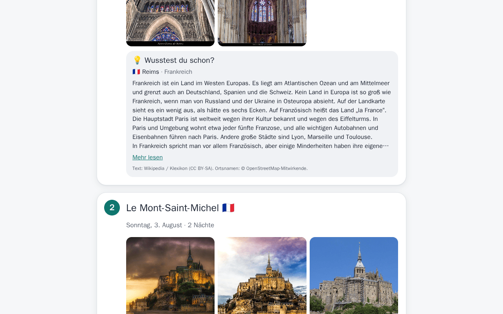

# TripAtlas – Anleitung

*English: [../user-guide.md](../user-guide.md) · Einrichten: [installation.md](installation.md)*

TripAtlas zeigt alle Reisen eurer Familie auf einer Karte: wo ihr gefahren seid, wo ihr übernachtet habt, welche
Fotos dabei entstanden sind und was es über die Orte zu wissen gibt. Zu jedem Abschnitt gibt es ein kurzes Video.

| Video | |
|---|---|
| [TripAtlas einrichten](../videos/de/01-einrichtung.mp4) | der Assistent, vom ersten Konto bis zu den ersten Reisen |
| [Karte und Reisen](../videos/de/02-karte-und-reisen.mp4) | eine Reise finden, abfahren, Zeitleiste, Titel und Notizen |
| [Wo war ich schon](../videos/de/03-wo-war-ich-schon.mp4) | der Globus, die Orte, die Flüge |
| [Familie und Kinder](../videos/de/04-familie-und-kinder.mp4) | Konten, Rollen und die Ansicht für Kinder |
| [Alte Reisen importieren](../videos/de/05-import.mp4) | GPX-Dateien und Google-Standortverlauf |
| [Auf dem Handy](../videos/de/06-handy.mp4) | dasselbe auf dem kleinen Bildschirm |

---

## Die Karte

- **Links** (auf dem Handy: unter der Karte) stehen eure Reisen, die neueste oben, nach Jahren geordnet. Jede Karte
  zeigt Datum, Nächte, Kilometer, Fotos und die Flaggen der Länder.
- **Auf der Karte** ist jede Reise eine Linie in der Farbe ihres Fahrzeugs. Darüber liegen eure Fotos als kleine
  Stapel; die Zahl sagt, wie viele Fotos darin stecken. Antippen öffnet sie.
- **Strecken** und **Fotos** schalten die Ebenen ein und aus. Bei mehreren Fahrzeugen blenden die farbigen Knöpfe
  jedes einzeln ein oder aus. Den Kartenstil (Straßen, Hell, Dunkel) wählt die Auswahlliste neben den Ebenen; der Knopf **⛶** oben links auf der
  Karte zeigt nur die Karte, im Vollbild. Der Knopf darunter blendet die Fotostapel aus (und wieder ein), auch
bei geöffneter Reise.
- Die Fotoebene zeigt **alle** Fotos mit Ort – auch von Reisen ohne Tracker, etwa einer Städtereise mit dem Zug.

### Was zählt als Reise?

Eine Reise beginnt, wenn ein Fahrzeug weiter als der Radius um Zuhause (4 km) weg ist **und** mindestens eine Nacht
auswärts verbringt – maßgeblich ist der Ort um 3 Uhr nachts. Ein Tagesausflug ist keine Reise. Kurz tagsüber zu Hause
beendet keine Reise, eine Nacht zu Hause schon. Jeder Übernachtungsort wird zu einer **Station**.

## Eine Reise

Eine Reise in der Liste oder ihre Linie auf der Karte antippen:

- **Titelbild, Titel, Datum** und die Zahlen: Nächte, Kilometer, Fotos, Länder. Als Titel steht der Ort mit den
  meisten Nächten – ändern mit **Titel & Notiz**.
- **Abfahren**: Der Schieber hat zwei Griffe. Die Strecke dazwischen wird auf der Karte gezeichnet, je Tag in einer
  Farbe; das Fahrzeug steht am rechten Griff. ▶ fährt die Strecke ab, **Mitfahren** hält die Karte beim Fahrzeug.
  Darunter erscheinen die Fotos aus dieser Zeit.
- **Zeitleiste**: Fahrten und Übernachtungen der Reihe nach, mit ihren Fotos. Antippen zeigt den Abschnitt auf der
  Karte.
- **Über diesen Ort** bei jeder Übernachtung: der Wikipedia-Text und Sehenswertes in der Nähe.
- **Notizen**: ein Text zur Reise und zu jeder Übernachtung – fett, kursiv, Listen, Links. Alle mit Zugriff sehen sie.

### Fotos und Videos

Ins Foto zoomen: mit zwei Fingern aufziehen oder doppelt tippen (am Rechner das Mausrad), dann mit einem Finger
verschieben; beim Hineinzoomen lädt die volle Auflösung nach. Doppelt tippen geht zurück; erst dann wischt man
wieder zum nächsten Foto.

Jedes Foto lässt sich groß ansehen. Wischen oder die Pfeiltasten blättern weiter; Videos laufen im selben
Betrachter, Esc schließt ihn. Der Raster-Knopf oben links zeigt **alle Fotos und Videos auf einmal** – 3, 2 oder 1
nebeneinander, Videos mit ▶; antippen öffnet ein Bild groß. Fotostapel auf der Karte öffnen gleich in dieser
Übersicht. Unter jedem Foto steht dezent, wann und wo es entstand (am Computer auch die Kamera); der Knopf **i**
unten rechts zeigt alles Weitere – Koordinaten, Kamera und Objektiv, Belichtung, Größe, Datei – und auf Wunsch jede
EXIF-Angabe aus der Datei.

**Zettel auf der Karte:** Im Betrachter heftet **📌 Zettel** einen kurzen Text an den Ort, an dem das gezeigte Foto
entstand („Unser erster Campingplatz“). Alle im Haushalt sehen ihn als kleinen gelben Zettel auf der Karte;
antippen öffnet *Fotos von hier*, Ändern und Entfernen. Ändern kann ihn nur, wer ihn angelegt hat, oder ein Administrator. In der Kinderansicht erscheinen keine Zettel.

Fotos ohne GPS (etwa von einer Kamera) setzt TripAtlas an die Stelle, an der das Fahrzeug zu der Zeit war.

## Wo war ich schon

Ein Globus mit einem Punkt für jeden Ort, an dem ihr wart – Übernachtungen und jeder Ort aus euren Fotos – und den
besuchten Ländern eingefärbt. Unten (am Computer: links) die Zahl der Länder und Orte und dazu die Länder mit der Zahl ihrer Orte.

Einen Punkt antippen: Name, Nächte, Fotos, der Wikipedia-Text – und **Fotos ansehen** öffnet alle Fotos dieses Ortes.

### Flüge

Handys zeichnen auch in der Luft ihren Ort auf. Fotos aus dem Flugzeugfenster landeten deshalb in Dörfern, über die
ihr nur hinweggeflogen seid. TripAtlas erkennt sie an der Höhe, die im Foto steht (und daran, wie schnell sich der Ort
geändert hat), und zeigt stattdessen den Flug: einen gestrichelten Bogen vom Abflug zur Ankunft mit ✈. Antippen
zeigt Strecke, Datum, Flughöhe und die Fotos aus dem Fenster.

## Konten für die Familie

Jeder meldet sich mit eigenem Namen und Passwort an. Der Administrator legt Konten unter **Einstellungen →
Benutzer** an und bestimmt, welche Fahrzeuge jemand sieht.

| | Administrator | Mitglied | Kind |
|---|---|---|---|
| Sieht Reisen | alle | der zugeteilten Fahrzeuge | der zugeteilten Fahrzeuge |
| Wo jemand gerade ist | ✓ | ✓ (abschaltbar) | nie (außer ausdrücklich erlaubt) |
| Titel, Notizen, Importe | ✓ | ✓ | – |
| Benutzer, Fahrzeuge, Verbindungen | ✓ | – | – |

### Konto wechseln

Dein Bild (oder das Personen-Symbol) oben rechts öffnet das Kontomenü – in der Kinderansicht ist es der Knopf
**Konto wechseln**: wer angemeldet ist, die anderen Konten, die auf diesem Gerät schon benutzt wurden, *Anderes
Konto …* und *Abmelden*. Wechseln meldet das bisherige Konto immer ab. Wer ein Konto antippt, kommt zur Anmeldeseite mit
eingetragenem Namen — das Passwort trägt der Passwortmanager des Browsers ein. In einer App, die das unterstützt,
bietet TripAtlas nach der Anmeldung an, das Passwort hinter dem Fingerabdruck zu speichern; dann genügen beim
Wechseln ein Tipp und der Finger. Ein Kind kommt ohne den Finger der Eltern nicht in deren Konto zurück. Im normalen Browser ist das Passwort das einzige
Schloss: Wer es kennt, kann sich anmelden.

### Die Ansicht für Kinder

Kinder bekommen ihr eigenes, einfaches TripAtlas: große Bilder, jede Reise als Geschichte mit einem Kapitel je Ort
und **Wusstest du schon?** mit einem Text für Kinder (aus dem [Klexikon](https://klexikon.zum.de)). Kinder können
nichts ändern und sehen nie, wo jemand gerade ist – das sperrt der Server, nicht nur die Oberfläche.

## Alte Reisen importieren

Reisen aus der Zeit vor dem Tracker: **Einstellungen → Import**, Fahrzeug wählen, Dateien wählen.

- **GPX** aus Navi-Apps, Sportuhren, Fahrradcomputern.
- **Google-Standortverlauf**: `Records.json` aus Google Takeout (bis 2024) oder der neuere *Zeitachse*-Export aus
  Google Maps (Android: *Einstellungen → Standort → Standortdienste → Zeitachse → Exportieren*).
- **GeoJSON** mit Zeitstempeln (etwa aus Dawarich oder OwnTracks).

Dieselbe Datei zweimal zu importieren schadet nicht – schon vorhandene Positionen werden übersprungen. Aufzeichnungen
mit einem Punkt je Sekunde werden auf höchstens einen Punkt alle 10 Sekunden ausgedünnt (mit dem Rad etwa 70 m); so
bleiben auch Jahre an Fahrten klein, und die Strecke ist trotzdem gut zu sehen.

### Radtouren

Tracker-Arten: **Fahrzeug** und **Wohnmobil** (eine Reise braucht eine Nacht auswärts), **Fahrrad** (unten) und **Person** (ein Tracker,
den jemand bei sich trägt, etwa eine Handy-App – zählt wie ein Fahrzeug, mit Personen-Piktogramm).

Einen Tracker der Art **Fahrrad** anlegen (*Einstellungen → Tracker*, Name z. B. „Fahrrad“, Art *Fahrrad*). Beim
Fahrrad zählt jede Tour, auch ohne Übernachtung (angezeigt als *Tagestour*), sobald sie mehr als einen Kilometer
über das Zuhause hinausgeht. Mehrere Touren vom Campingplatz aus während eines Urlaubs ergeben eine Reise. Dann die
Fahrten als GPX in diesen Tracker importieren – auch der Export aller Fahrten einer Fahrrad-App in einer Datei
(etwa *CurruBike → Einstellungen → Alle Fahrten als GPX*). Später mit neueren Fahrten einfach wieder importieren:
was schon da ist, wird übersprungen.

## Auf dem Handy

TripAtlas im Browser des Handys öffnen und *Zum Startbildschirm hinzufügen* wählen – dann startet es wie eine App
(braucht HTTPS). Die Seite passt sich an: oben die Karte, darunter die Liste; der Bildbetrachter geht mit Wischen.

### Speicher auf diesem Gerät

Kartenteile und die Fotos, die du angesehen hast, bleiben auf dem Handy oder Rechner – Karte und Fotoübersicht
öffnen dadurch schneller und gehen auch ohne Netz. Die Größe stellst du unter **Einstellungen → Profil → Speicher
auf diesem Gerät** ein (aus, 0,5, 1, 2 oder 5 GB; ohne Änderung 1 GB). Ist er voll, fliegt zuerst raus, was am
längsten nicht angesehen wurde. Jedes Konto auf dem Gerät behält seine eigenen Fotos und Reisen – beim Konto-Wechsel
bleiben sie erhalten, und niemand sieht darüber die Fotos eines anderen Kontos. Wer ein Konto im Kontomenü
entfernt (×), entfernt auch seine gespeicherten Fotos.

Bevor es irgendwohin ohne Netz geht: die Reise öffnen und ganz unten **Offline speichern** tippen. Dann liegen
Kartenausschnitt, Fotos und Angaben der Reise auf dem Gerät (eine lange Reise mit ein paar tausend Fotos braucht
einige hundert MB). Das geht nur über HTTPS (oder `localhost`) – über einfaches `http://` lassen Browser es nicht zu.

## Eigene Einstellungen

**Einstellungen → Profil**: dein Bild (wählen, im runden Rahmen zuschneiden oder entfernen), Name, Sprache,
Passwort und auf Wunsch ein eigener Immich-Schlüssel (dann siehst du genau deine Fotos und die mit dir geteilten).
Die Bilder der anderen Konten, etwa der Kinder, setzt der Administrator unter **Einstellungen → Benutzer**.

## Häufige Fragen

**Eine Reise fehlt oder zwei Reisen sind zusammengewachsen.** Der Administrator prüft unter *Einstellungen →
Haushalt* das Zuhause, den Radius und die Mindestzahl an Nächten.

**Ein Ort hat noch keinen Namen.** Namen und Lexikontexte werden im Hintergrund nachgeschlagen, ein paar pro Minute.

**Videos ruckeln auf dem Handy.** Immich schickt Videos so, wie sie aufgenommen wurden (oft 15–25 Mbit/s), solange
es keine kleineren Fassungen für die Wiedergabe anlegt. In Immich als Administrator: *Administration →
Einstellungen → Video-Transkodierung*, Richtlinie *Optimal*, Zielauflösung 720p; danach *Administration → Aufträge →
Videos transkodieren → Alle*. Solange Immich nicht so eingestellt ist, zeigen der Videobetrachter und *Einstellungen →
Status* einen Hinweis (TripAtlas kann das nur erkennen, wenn sein Immich-Schlüssel einem Immich-Administrator gehört).

**Wo liegen meine Fotos?** Weiter in Immich. TripAtlas zeigt sie an, kopiert oder ändert sie aber nie.

**Wer kann sehen, wo wir sind?** Nur Konten, die Live-Positionen sehen dürfen, und nur für die Fahrzeuge, die ihnen
zugeteilt sind. Kinder nie: Sie sehen Positionen und Fotos erst nach 6 Stunden und eine Reise erst, wenn sie vorbei
ist. Wird ein Konto zum Kinderkonto gemacht, verliert es den Live-Zugang.

**Wer sieht welche Fotos?** Alle, die den Immich-Schlüssel des Haushalts nutzen, sehen alle Fotos dieses Schlüssels;
ein Konto mit eigenem Immich-Schlüssel (*Einstellungen → Profil*) sieht genau, was dieser Schlüssel darf.
