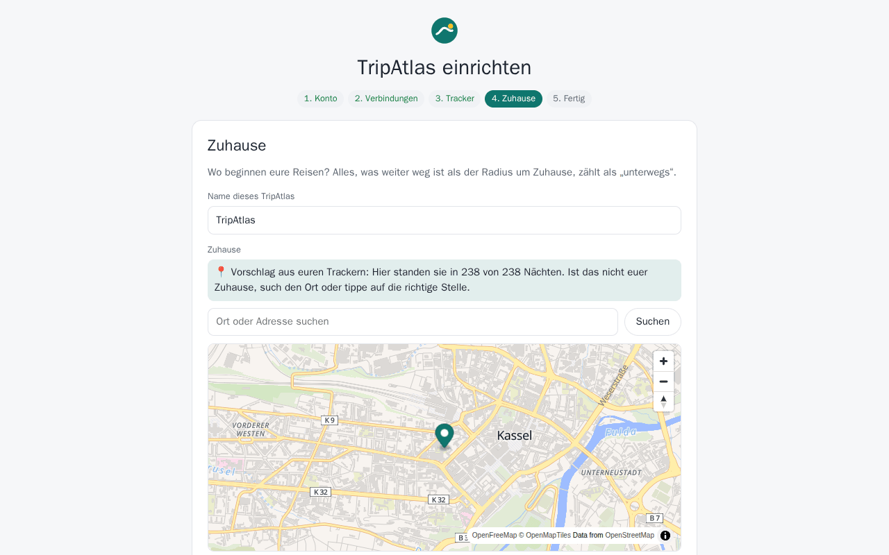

# TripAtlas einrichten

*English: [../installation.md](../installation.md)*

Von null bis zum laufenden TripAtlas mit euren Trackern und Fotos – etwa 15 Minuten.
Lieber zuschauen? **[Video: TripAtlas einrichten](../videos/de/01-einrichtung.mp4)** (3 Minuten).

## Was ihr braucht

| | |
|---|---|
| Einen Server mit Docker | Alles, worauf Docker läuft: NAS, Mini-PC, Raspberry Pi 4/5 (64 Bit), virtuelle Maschine. TripAtlas braucht etwa 150 MB Arbeitsspeicher. |
| [Traccar](https://www.traccar.org) *(freiwillig)* | Der GPS-Server, an den eure Tracker melden. TripAtlas liest dort nur. Ohne Traccar lassen sich trotzdem GPX-Dateien und der Google-Standortverlauf importieren. |
| [Immich](https://immich.app) *(freiwillig)* | Eure Fotosammlung. TripAtlas liest dort nur – Fotos werden weder kopiert noch verändert. |

Erst einmal umschauen? Die **[Demo](../demo.md)** bringt eine erfundene Familie samt Trackern und Fotos mit.

## 1. TripAtlas starten

```bash
mkdir -p tripatlas/data && cd tripatlas
curl -o compose.yaml https://raw.githubusercontent.com/supremedk1985/tripatlas/main/docker/compose.example.yaml
docker compose up -d
```

Den Ordner `data` **vor** dem ersten Start mit dem eigenen Benutzer anlegen, wie oben: TripAtlas läuft als Benutzer
1000 und muss dort schreiben dürfen. Hat Docker den Ordner zuerst angelegt, gehört er root, und TripAtlas bricht mit
*„cannot write to /data“* ab — `sudo chown -R 1000:1000 data` behebt das.

**Port oder Name schon belegt?** In `compose.yaml` die linke Zahl bei `ports:` ändern (z. B. `"8100:8097"` → dann
`http://<euer-server>:8100` öffnen) und, falls schon ein anderer Container `tripatlas` heißt, den `container_name`.

`http://<euer-server>:8097` öffnen. Laufen Traccar und Immich auf demselben Rechner in anderen Docker-Projekten,
im Assistenten die IP-Adresse des Servers angeben (z. B. `http://192.168.1.10:8082`) oder den Docker-Netzen beitreten
(Kommentar in `compose.yaml`).

## 2. Zugang zu Traccar vorbereiten

TripAtlas braucht ein Traccar-Konto, das eure Geräte **sehen** darf. Empfohlen: ein eigener Benutzer nur zum Lesen.

1. In Traccar: *Einstellungen → Benutzer → +*, z. B. `tripatlas` anlegen, **Nur lesen** anhaken.
2. *Einstellungen → Geräte*: die Geräte (Wohnmobil, Auto …) diesem Benutzer zuordnen.
3. Im Assistenten E-Mail und Passwort dieses Benutzers eintragen – oder einen Token erzeugen: als dieser Benutzer
   anmelden, *Einstellungen → Benutzereinstellungen → Token → erzeugen*.

## 3. Zugang zu Immich vorbereiten

1. In Immich: *Kontoeinstellungen → API-Schlüssel → Neuer API-Schlüssel*.
2. Berechtigungen: am einfachsten *alle* (TripAtlas liest nur). Wer einschränkt: Fotos lesen und durchsuchen,
   Vorschaubilder zeigen, Originale herunterladen (nur die ersten Kilobyte, für die Flugerkennung), die Kartenpunkte
   und den eigenen Benutzer lesen.
3. Fotos von Partnern, mit denen ihr in Immich teilt, sind automatisch dabei.

Jedes Familienmitglied kann später im Profil einen **eigenen** Schlüssel hinterlegen und sieht dann genau seine Fotos.
Ohne eigenen Schlüssel nutzen alle (auch Kinder) den Schlüssel aus dem Assistenten.

## 4. Der Einrichtungsassistent

| Schritt | Was passiert |
|---|---|
| **Konto** | Administrator anlegen, Sprache wählen. |
| **Verbindungen** | Traccar-Adresse und Token (oder E-Mail und Passwort), Immich-Adresse und API-Schlüssel. *Testen & speichern* prüft sie; *Weiter* speichert Eingetipptes ebenfalls. Beides ist freiwillig. |
| **Tracker** | Die Traccar-Geräte anklicken, denen ihr folgen wollt. Ohne Traccar einen Tracker mit Namen für Importe anlegen. |
| **Zuhause** | TripAtlas schlägt das Zuhause vor – dort, wo die Tracker die meisten Nächte stehen. Mit der Suche oder per Antippen korrigieren. **Das ist wichtig:** Eine Reise ist eine Zeit fern von zu Hause mit mindestens einer Nacht auswärts. Die **Zeitzone** daneben legt fest, was „Nacht“ heißt (TripAtlas sieht nach, wo der Tracker um 3 Uhr war); sie startet mit dem `TZ` des Servers aus `compose.yaml`. |
| **Fertig** | TripAtlas holt den Verlauf (bis zu drei Jahre) und erkennt eure Reisen. Die Karte zeigt das an und füllt sich von selbst – ein paar Minuten für ein Jahr Daten. |



## 5. Zugang von unterwegs (freiwillig)

In TripAtlas steht, wo eure Familie war und ist – nur mit Bedacht nach außen öffnen:

- Hinter einen Reverse-Proxy mit HTTPS stellen und `TRIPATLAS_SECURE_COOKIES=true` setzen. Beispiel für Caddy:

  ```
  reisen.example.org {
      reverse_proxy 127.0.0.1:8097
  }
  ```
- Oder gar nicht öffnen und unterwegs per VPN (WireGuard, Tailscale) ins Heimnetz gehen.
- Passwörter mit mindestens 8 Zeichen; nach 5 Fehlversuchen pausiert ein Konto auf diesem Gerät 15 Minuten
  (andere Konten sind nicht betroffen).
- Die Adresse des Geräts (für diese Grenze) nimmt TripAtlas nur dann aus `X-Forwarded-For`, wenn die Anfrage aus einem
  privaten Netz kommt, also vom eigenen Proxy. Steht der Proxy woanders, `FORWARDED_ALLOW_IPS` auf seine Adresse setzen.

Als App: TripAtlas über HTTPS in Chrome/Safari auf dem Handy öffnen → *Zum Startbildschirm hinzufügen*.

## 6. Sicherung

Den Ordner `data/` sichern. TripAtlas legt jeden Tag eine saubere Kopie seiner Datenbank in `data/backups/` ab (sieben
bleiben), eine nächtliche Dateisicherung ist also auch im laufenden Betrieb sicher. `secret.key` gehört dazu – damit
werden die gespeicherten Zugangsdaten zu Traccar und Immich entschlüsselt.

**Wiederherstellen:** `docker compose down`, eine Datei aus `data/backups/` über `data/tripatlas.db` kopieren,
`docker compose up -d`.

## 7. Aktualisieren

```bash
docker compose pull && docker compose up -d
```

Änderungen an der Datenbank werden beim Start von selbst eingespielt. Vor einer neuen Hauptversion die Hinweise zur
Version lesen.

## Wenn etwas nicht geht

| Problem | Was tun |
|---|---|
| „Zu viele Versuche“ | 15 Minuten warten oder den Container neu starten (die Sperre liegt im Speicher). |
| Keine Reisen | *Einstellungen → Status*: Kommen Positionen an? Stimmt das Zuhause? Eine Reise braucht eine Nacht auswärts (der Ort um 3 Uhr zählt). |
| Keine Fotos | *Einstellungen → Verbindungen → Testen & speichern* bei Immich. Fotos brauchen GPS oder müssen während einer aufgezeichneten Reise entstanden sein. |
| Reisen falsch getrennt | *Einstellungen → Haushalt → Reiseerkennung anpassen*: Radius, Mindestnächte, Mindestabstand, alte Positionen ignorieren. |
| Ortsnamen / Wikipedia fehlen | Werden im Hintergrund nachgeschlagen, ein paar pro Minute. Unter *Einstellungen → Haushalt* abgeschaltet? |

Etwas anderes? [Ein Issue anlegen](https://github.com/supremedk1985/tripatlas/issues).
