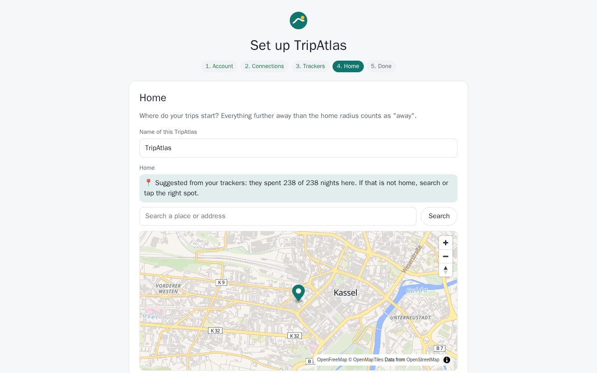

# Installing TripAtlas

*Deutsch: [de/installation.md](de/installation.md)*

This guide takes you from nothing to a running TripAtlas with your trackers and photos — about 15 minutes.
Prefer watching? **[Video: setting up TripAtlas](videos/en/01-setup.mp4)** (3 min).

## What you need

| | |
|---|---|
| A server with Docker | Anything that runs Docker: a NAS, a mini PC, a Raspberry Pi 4/5 (64-bit), a virtual machine. TripAtlas needs about 150 MB of RAM. |
| [Traccar](https://www.traccar.org) *(optional)* | The GPS server your trackers report to. TripAtlas only reads from it. Without Traccar you can still import GPX files and Google location history. |
| [Immich](https://immich.app) *(optional)* | Your photo library. TripAtlas only reads from it — photos are never copied or changed. |

Just want to look around first? The **[demo](demo.md)** brings its own made-up family, trackers and photos.

## 1. Start TripAtlas

```bash
mkdir -p tripatlas/data && cd tripatlas
curl -o compose.yaml https://raw.githubusercontent.com/supremedk1985/tripatlas/main/docker/compose.example.yaml
docker compose up -d
```

Create `data` **before** the first start, as your own user, as above: TripAtlas runs as user 1000 and must be able
to write there. If Docker created the folder first, it belongs to root and TripAtlas stops with *"cannot write to
/data"* — `sudo chown -R 1000:1000 data` fixes it.

**Port or name already taken?** Change the left side of `ports:` in `compose.yaml` (e.g. `"8100:8097"` → open
`http://<your-server>:8100`) and, if another container is called `tripatlas`, the `container_name`. To edit the file
in the terminal: `nano compose.yaml`, change the line, save with *Ctrl+O, Enter*, leave with *Ctrl+X*, then run
`docker compose up -d` again.

**Traccar and Immich on the same machine?** In the wizard use the server's own address, not `localhost` (inside
TripAtlas, `localhost` is TripAtlas itself). `hostname -I` in the terminal shows it, e.g. `192.168.1.10` →
`http://192.168.1.10:8082` for Traccar and `http://192.168.1.10:2283` for Immich.

Open `http://<your-server>:8097`. If Traccar and Immich run on the same machine in other Docker projects, either use
the server's IP address in the wizard (e.g. `http://192.168.1.10:8082`) or join their Docker networks
(see the comment in `compose.yaml`).

## 2. Prepare access to Traccar

TripAtlas needs a Traccar account that can **see** your devices. Recommended: a separate read-only user.

1. In Traccar: *Settings → Users → +*, create e.g. `tripatlas`, tick **Read-only**.
2. *Settings → Devices*: link the devices (camper van, car …) to this user.
3. Either use the user's e-mail and password in TripAtlas, or create a token: log in as that user, *Settings →
   Preferences → Token → generate*.

## 3. Prepare access to Immich

1. In Immich: *Account settings → API keys → New API key*.
2. Permissions: simplest is *all* (TripAtlas only reads). If you restrict the key, it must be able to read and
   search assets, show thumbnails, download originals (only the first few kilobytes, for flight detection), read the
   map markers and read the own user.
3. Photos of partners you share with in Immich are included automatically.

Each family member can later add **their own** key in their profile, then they see exactly their photos. Without
one, everybody (including children) uses the household key from the wizard.

## 4. The setup wizard

| Step | What happens |
|---|---|
| **Account** | Create the administrator. Choose the language. |
| **Connections** | Traccar address + token (or e-mail and password), Immich address + API key. *Test & save* checks them; *Next* also saves whatever you typed. Both are optional. |
| **Trackers** | Click the Traccar devices you want to follow. Without Traccar, create a tracker by name for imports. |
| **Home** | TripAtlas suggests your home from where the trackers spend most nights. Search or tap the map to correct it. **This matters:** a trip is a time away from home with at least one night away. The **time zone** next to it decides what "night" means (TripAtlas looks where the tracker was at 3 a.m.); it starts as the server's `TZ` from `compose.yaml`. |
| **Done** | TripAtlas fetches the history (up to three years) and recognises your trips. The map says so while it works and fills in by itself — a few minutes for a year of data. |



## 5. Access from outside (optional)

TripAtlas holds your family's whereabouts — expose it carefully:

- Put it behind a reverse proxy with HTTPS and set `TRIPATLAS_SECURE_COOKIES=true`. Example for Caddy:

  ```
  trips.example.org {
      reverse_proxy 127.0.0.1:8097
  }
  ```
- Or don't expose it at all and use a VPN (WireGuard, Tailscale) to reach your home network.
- Passwords: at least 8 characters; after 5 wrong attempts an account pauses for 15 minutes on that device
  (other accounts are not affected).
- Client addresses (for that limit) are taken from `X-Forwarded-For` only when the request comes from a private
  network, i.e. your proxy. If your proxy is elsewhere, set `FORWARDED_ALLOW_IPS` to its address.

Installed as an app: open TripAtlas over HTTPS in Chrome/Safari on the phone → *Add to home screen*.

## 6. Backups

Back up the `data/` folder. TripAtlas writes a consistent copy of its database to `data/backups/` every day (seven
are kept), so a nightly file backup is safe while it runs. Keep `secret.key` with it — it decrypts the stored
Traccar/Immich credentials.

**Restore:** `docker compose down`, copy a file from `data/backups/` over `data/tripatlas.db`, `docker compose up -d`.

## 7. Updates

```bash
docker compose pull && docker compose up -d
```

Database changes are applied automatically at start. Read the release notes before a major version.

## Troubleshooting

| Problem | What to do |
|---|---|
| "Too many failed attempts" | Wait 15 minutes, or restart the container (the lock is kept in memory). |
| No trips appear | *Settings → Status*: are positions arriving? Is the home location right? A trip needs a night away (the position at 3 a.m. counts). |
| No photos | *Settings → Connections → Test & save* for Immich. Photos need GPS or must be taken during a tracked trip. |
| Wrong trip boundaries | *Settings → Household → Adjust trip detection*: home radius, minimum nights, minimum distance, ignore old positions. |
| Place names / Wikipedia missing | They are looked up in the background, a few per minute. Turned off under *Settings → Household*? |

Something else? [Open an issue](https://github.com/supremedk1985/tripatlas/issues).
