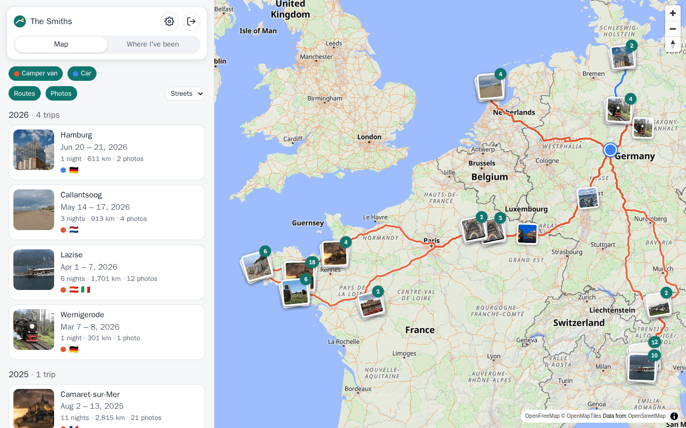
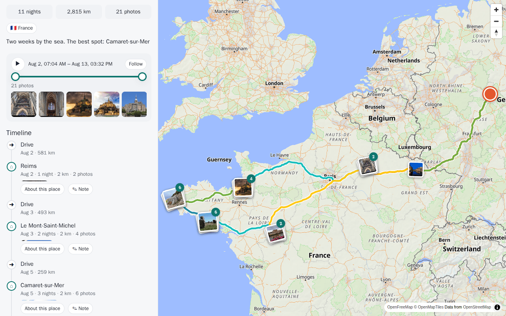
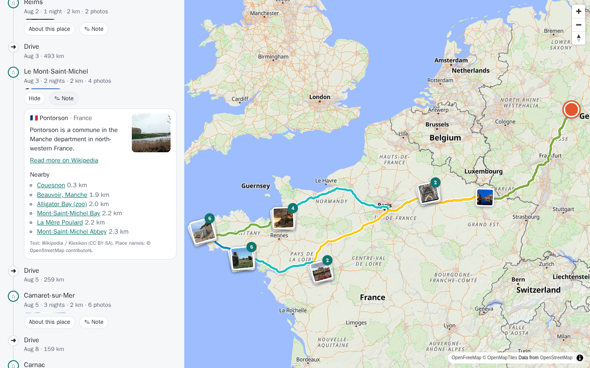
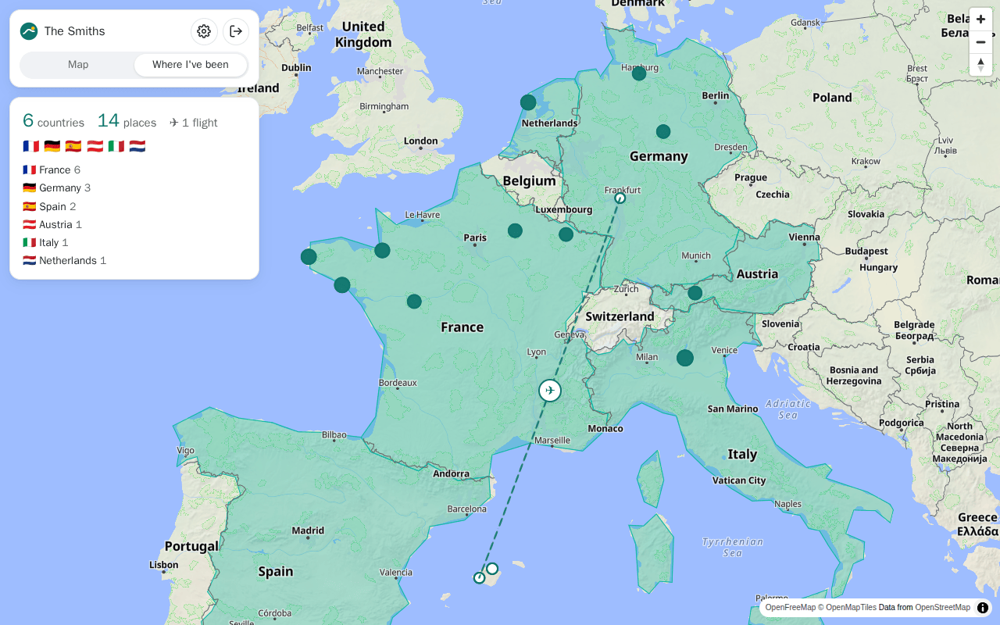
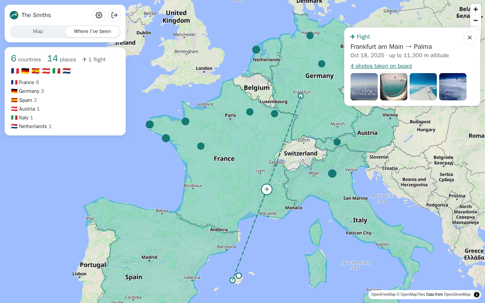
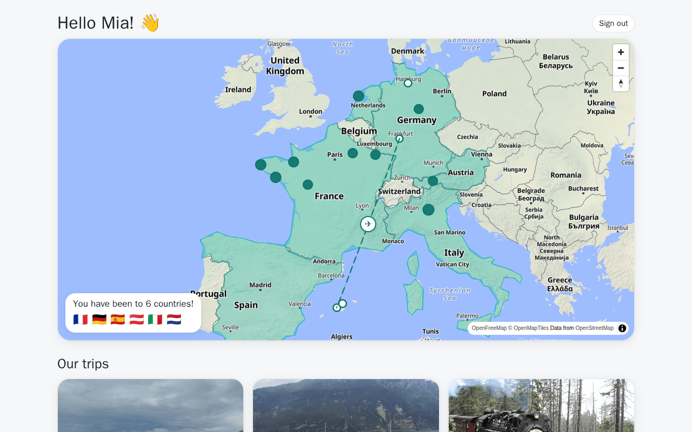
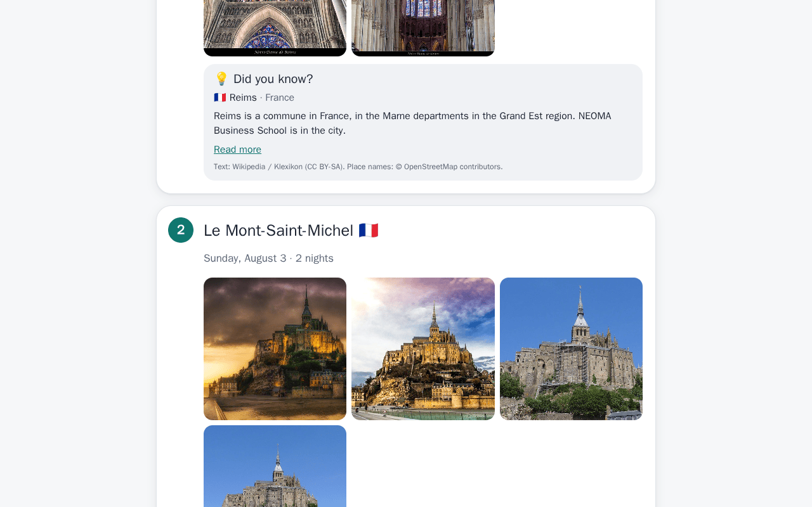

# TripAtlas user guide

*Deutsch: [de/anleitung.md](de/anleitung.md) · Setting up: [installation.md](installation.md)*

TripAtlas shows every trip your family took on one map — where you drove, where you slept, the photos you took and
what is worth knowing about the places. Every section has a short video.

| Video | |
|---|---|
| [Setting up TripAtlas](videos/en/01-setup.mp4) | the wizard, from the first account to the first trips |
| [Map and trips](videos/en/02-map-and-trips.mp4) | finding a trip, replaying it, the timeline, titles and notes |
| [Where I've been](videos/en/03-where-ive-been.mp4) | the globe, places, flights |
| [Family and children](videos/en/04-family-and-kids.mp4) | accounts, roles and the children's view |
| [Importing old trips](videos/en/05-import.mp4) | GPX files and Google location history |
| [On the phone](videos/en/06-phone.mp4) | the same on a small screen |

---

## The map

- **Left** (on a phone: below the map) are your trips, newest first, grouped by year. Each card shows the dates,
  nights, kilometres, photos and the flags of the countries.
- **On the map** each trip is a line in the colour of its vehicle. Your photos lie on top as small stacks; the
  number says how many photos are in a stack. Tap a stack to look through them.
- **Routes** and **Photos** switch the layers on and off. With several vehicles, the coloured buttons show or hide
  each one. The map style (streets, light, dark) is chosen in the drop-down next to the layers; the **⛶** button at the top left
of the map shows only the map, full screen.
- The photo layer shows **all** photos with a location — also from trips without a tracker, like a city trip by
  train.

### What counts as a trip?

A trip starts when a vehicle is further away from home than the home radius (4 km by default) **and** spends at
least one night away — the position at 3 a.m. counts. A day trip is not a trip. A quick stop at home during the
day does not end a trip; a night at home does. Every night's location becomes an **overnight stay**.

## A trip

Tap a trip in the list or its line on the map:

- **Cover photo, title, dates** and the numbers: nights, kilometres, photos, countries. The title is the place where
  you spent most nights — change it with **Title & note**.
- **Replay**: the slider has two handles. The route between them is drawn on the map, coloured by day; the vehicle
  stands at the right handle. ▶ drives the route; **Follow** keeps the map on the vehicle. Below are the photos of
  the selected time.
- **Timeline**: drives and overnight stays in order, with their photos. Tap an entry to show it on the map.
- **About this place** on every stay: the Wikipedia summary and sights nearby.
- **Notes**: a text for the trip and for every stay — bold, italic, lists, links. Everybody with access sees them.

### Photos and videos

Tap any photo to see it large. Swipe or use the arrow keys to move on; videos play in the same viewer, Esc closes it.
The grid button at the top left shows **all photos and videos at once** — 3, 2 or 1 per row, videos marked with ▶;
tap one to see it large. Photo stacks on the map open in this overview straight away. Under each photo a quiet line
says when and where it was taken (on a computer also the camera); the **i** button at the bottom right shows
everything else — coordinates, camera and lens, exposure, size, file — and, on request, every EXIF entry in the file.

**Notes on the map:** in the viewer, **📌 Note** pins a short note where the photo shown was taken ("our first
campsite"). Everyone in the household sees it as a small yellow note on the map; tap it for *Photos from here*, to
change or to remove it. Only its author or an administrator can change a note. Notes are not shown in the
children's view. Photos without GPS (from a
camera, for example) are placed where the vehicle was at that time.

## Where I've been

A globe with a pin for every place you have been — overnight stays and every town in your photos — and the visited
countries filled in. At the bottom (on a computer: left) the number of countries and places, and the countries with how many places each.

Tap a pin: name, nights, photos, the Wikipedia summary — and **Show photos** opens all photos of that place.

### Flights

Phones record a position in the air too, so photos from the plane window would end up in villages you only flew
over. TripAtlas recognises them by the altitude stored in the photo (and how fast the position changed) and shows
the flight instead: a dashed arc from departure to arrival with a ✈. Tap it to see the route, the date, the
altitude and the photos from the window.

## Family accounts and roles

Everybody signs in with their own name and password. The administrator creates accounts under
**Settings → Users** and decides which vehicles each person sees.

| | Administrator | Member | Child |
|---|---|---|---|
| Sees trips | all | of the assigned vehicles | of the assigned vehicles |
| Where someone is right now | ✓ | ✓ (can be turned off) | never (unless allowed) |
| Titles, notes, imports | ✓ | ✓ | – |
| Users, vehicles, connections | ✓ | – | – |

### Switching accounts

Your picture (or the person icon) at the top right opens the account menu — in the children's view it is the
**Switch account** button: who is signed in, the other accounts used on this device, *Another account…* and *Sign
out*. Switching always signs the current account out. Picking an account opens the sign-in page with the name filled
in — your browser's password manager can fill in the password. In an app that supports it (see
[App bridge](architecture.md#app-bridge)), TripAtlas offers to keep the password behind your fingerprint; switching
is then one tap and a fingerprint, and a child cannot get back into a parent's account without the parent's
fingerprint. In a plain browser the password is the only lock: anyone who knows it can sign in.

### The children's view

Children get their own, simple TripAtlas: big pictures, every trip as a story with a chapter per place, and
**Did you know?** with a text written for children (from [Klexikon](https://klexikon.zum.de) in German, Simple
English Wikipedia in English). Children cannot change anything, and they never see where someone is right now — the
server enforces this, not just the screen.

## Importing old trips

Trips from before you had a tracker: **Settings → Import**, choose the vehicle and the files.

- **GPX** from navigation apps, sports watches, bike computers.
- **Google location history**: `Records.json` from Google Takeout (until 2024), or the newer *Timeline* export from
  the Google Maps app (Android: *Settings → Location → Location services → Timeline → Export*).
- **GeoJSON** with timestamps (e.g. from Dawarich or OwnTracks).

Importing the same file twice does no harm — positions that already exist are skipped. Recordings with a point
every second are thinned to at most one point every 10 seconds (about 70 m by bike); that keeps years of rides small
and still draws the route.

### Bike rides

Tracker kinds: **Vehicle** and **Camper van** (trips need a night away), **Bicycle** (below) and **Person** (a tracker someone
carries, e.g. a phone app — counted like a vehicle, shown with a person pictogram).

Create a tracker of the kind **Bicycle** (*Settings → Trackers*, name it e.g. "Bike", choose *Bicycle*). For a
bicycle every ride counts, also a day ride without a night away (shown as *day ride*), as soon as it leaves the
home area by more than a kilometre. Several rides from a campsite during a holiday become one trip. Then import the
rides as GPX into that tracker — a bike app's export of all rides in one file works (for example *CurruBike →
Settings → All rides as GPX*). Import it again later with newer rides: the ones already there are skipped.

## On the phone

Open TripAtlas in the phone's browser and choose *Add to home screen* — it then starts like an app (needs HTTPS).
The layout adapts: the map on top, the list below; the photo viewer works with swipes.

### Storage on this device

Map tiles and the photos you have looked at stay on the phone or computer, so the map and the photo overview open
faster and also work without network. Set the size under **Settings → Profile → Storage on this device** (off,
0.5, 1, 2 or 5 GB; 1 GB unless changed); when it is full, what was looked at longest ago goes first. Each account on
the device keeps its own photos and trips — switching accounts keeps them, and nobody sees another account's photos
from it. Removing an account from the account menu (×) also removes its stored photos.

Before driving somewhere without network, open the trip and tap **Save for offline** at the end of the trip: its
map area, photos and details are then stored (a long trip with a couple of thousand photos takes a few hundred MB).
This needs HTTPS (or `localhost`): over plain `http://` browsers do not allow it.

## Your settings

**Settings → Profile**: your picture (choose one, crop it in the round frame, or remove it), name, language,
password, and optionally your own Immich API key (then you see exactly your photos and those shared with you).
Administrators set the pictures of the other accounts, for example the children's, under **Settings → Users**.

## Questions

**A trip is missing or two trips are merged.** Ask the administrator to check *Settings → Household*: the home
location, the home radius, the minimum number of nights.

**A place has no name yet.** Names and encyclopedia texts are looked up in the background, a few per minute.

**Where are my photos stored?** In Immich, as before. TripAtlas shows them but never copies or changes them.

**Who can see where we are?** Only accounts that may see live positions, and only for the vehicles they were
given. Children never: they see positions and photos only after a delay of 6 hours, and a trip only once it is
over. Making an account a child takes live access away.

**Who can see which photos?** Everyone who uses the household's Immich key sees all photos of that key; an account
with its own Immich key (*Settings → Profile*) sees exactly what that key may see.
